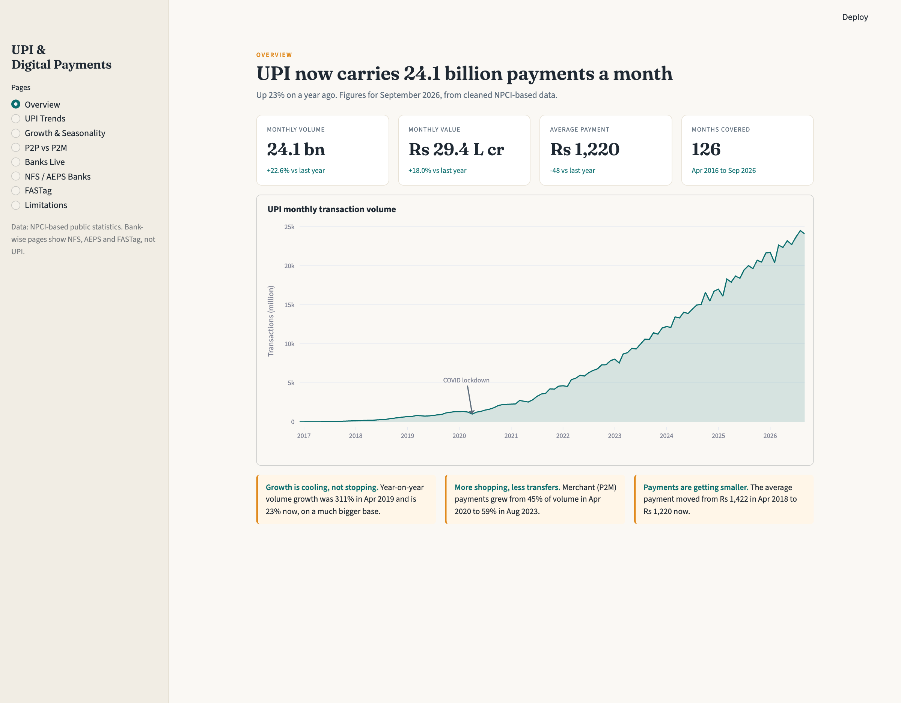
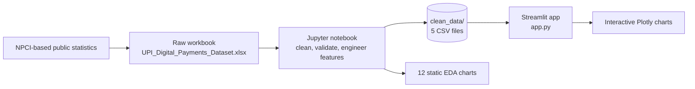
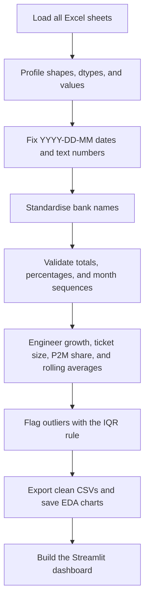
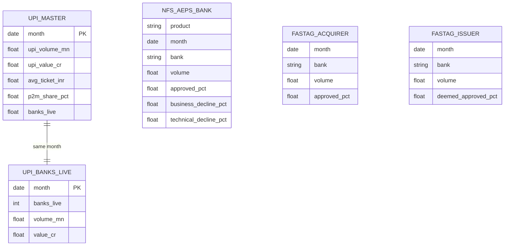
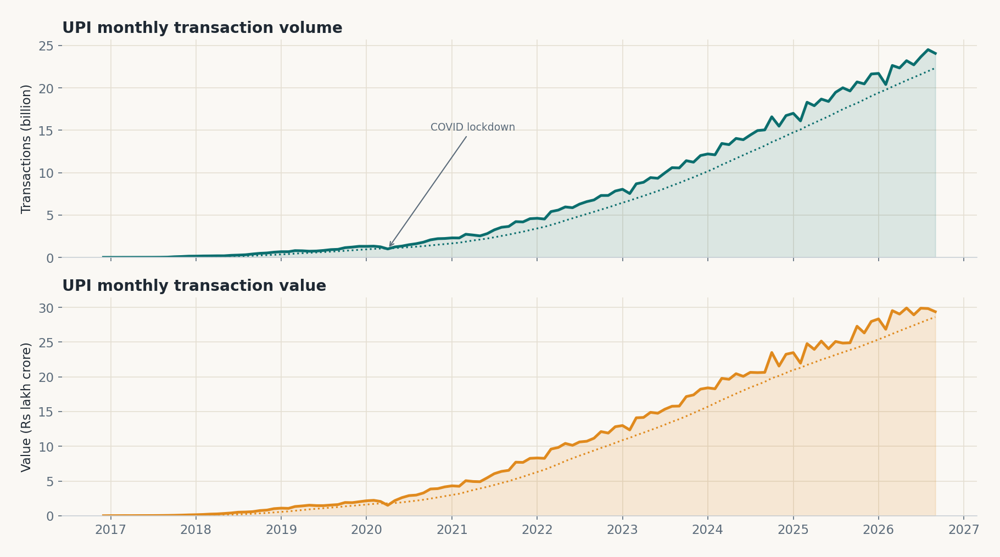
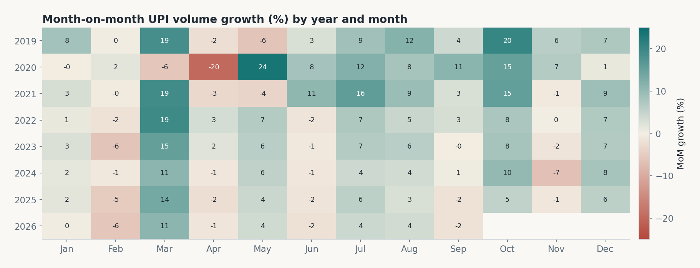
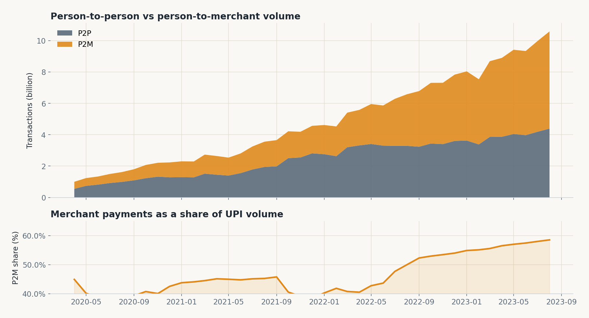
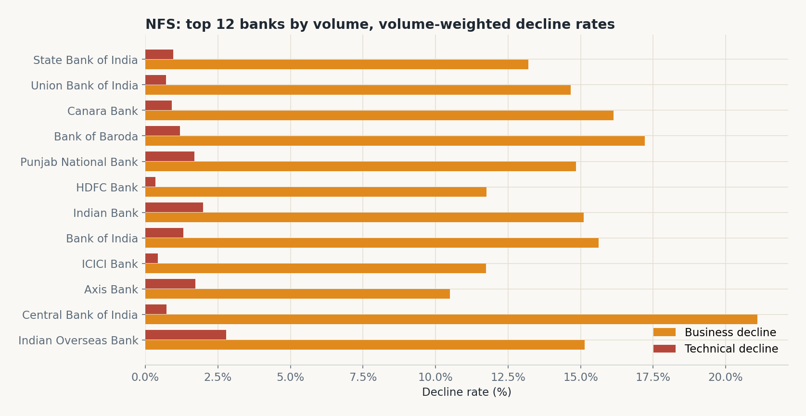

<div align="center">

# UPI & Digital Payments Analytics

### From messy Excel sheets to a clean, interactive payments dashboard

[](https://www.python.org/)
[](https://streamlit.io/)
[](https://plotly.com/python/)
[](https://pandas.pydata.org/)
[](LICENSE)

**A complete Data Science Project (DSP)** covering data understanding, cleaning, validation, feature engineering, outlier analysis, exploratory data analysis, and an interactive 8-page Streamlit dashboard.

[Overview](#overview) · [Dashboard](#the-dashboard) · [Architecture](#architecture) · [Findings](#key-findings) · [Run locally](#getting-started)

</div>



> **Data through September 2026.** In the latest month, UPI processed **24.1 billion** transactions worth **₹29.4 lakh crore**, with an average payment of **₹1,220**.

---

## Overview

India's Unified Payments Interface (UPI) is one of the largest real-time payment systems in the world. This project takes raw, inconsistent public statistics, turns them into a validated analysis-ready dataset, and presents the results as an interactive dashboard.

The project answers questions such as:

- How fast are UPI volume and value growing?
- Are payments getting smaller or larger over time?
- Is UPI becoming a merchant payment tool rather than only a transfer tool?
- Which months are seasonally strong or weak?
- Do more banks on UPI mean more transactions?
- Which banks have the highest decline rates in NFS, AEPS, and FASTag?

The repository contains both halves of the work:

1. **The notebook** — data profiling, cleaning, validation, feature engineering, outlier detection, and 12 EDA charts.
2. **The Streamlit app** — an interactive dashboard built on the cleaned CSV files.

---

## Project at a glance

| Item | Detail |
|---|---|
| Domain | Digital payments / FinTech analytics |
| Data coverage | April 2016 - September 2026 |
| UPI monthly records | 126 months |
| Bank-level records | 2,294 NFS/AEPS rows, 100 FASTag acquirer rows, 273 FASTag issuer rows |
| Cleaning steps | Date repair, text-to-number conversion, bank-name standardisation, validation, feature engineering, outlier flags |
| Dashboard pages | 8 |
| Main tools | Python, Pandas, NumPy, Plotly, Matplotlib, Streamlit, Jupyter |

### Key numbers

| Metric | Latest value |
|---|---|
| Monthly UPI volume | **24.1 billion** transactions (+22.6% YoY) |
| Monthly UPI value | **₹29.4 lakh crore** (+18.0% YoY) |
| Average payment size | **₹1,220** |
| Five-year volume CAGR | **45.8%** (Sep 2021 to Sep 2026) |
| Banks live on UPI | **756** (Sep 2026) |
| P2M share of volume | **58.5%** (Aug 2023, latest available) |
| Share of merchant payments | Up from **44.9%** in Apr 2020 |

---

## The dashboard

The dashboard has eight pages, each focused on one question.

| Page | What it shows |
|---|---|
| **Overview** | Headline KPIs, UPI volume trend, and three quick insights |
| **UPI Trends** | Volume and value over time, date filtering, rolling averages, log scale, average ticket size |
| **Growth & Seasonality** | YoY and MoM growth, a month-by-year heatmap, and flagged outlier months |
| **P2P vs P2M** | Person-to-person versus person-to-merchant volume and the changing merchant share |
| **Banks Live** | Number of banks live on UPI compared with transaction volume |
| **NFS / AEPS Banks** | Bank-wise approval, business decline, and technical decline rates |
| **FASTag** | Acquirer approval rates and issuer deemed-approved shares |
| **Limitations** | An honest summary of data coverage gaps and cleaning decisions |

The app uses a custom Plotly theme, a warm paper-like visual style, and volume-weighted bank comparisons so that small banks cannot distort the results.

### Dashboard design choices

- **Volume-weighted rates** — a bank with millions of transactions counts more than a tiny bank with a handful.
- **Gaps are kept as gaps** — missing months are not filled with invented values, so a broken line means the source data is missing.
- **Outliers are flagged, not deleted** — real events such as the COVID-19 lockdown remain visible.
- **Every page states its caveats** — for example, the bank-wise pages clearly say they cover NFS, AEPS, and FASTag, not UPI.

---

## Architecture



The notebook is the single source of truth for cleaning. The dashboard only reads the exported CSV files, which keeps the app fast and makes the analysis reproducible.

### Data pipeline



### Data model



---

## Datasets

The raw workbook contains multiple sheets, each with different problems. The cleaned versions are stored in `clean_data/`.

| Sheet | Grain | Coverage | Clean rows | Used for |
|---|---|---|---|---|
| `UPI_Master` | One row per month | Apr 2016 - Sep 2026 | 126 | UPI volume, value, P2P/P2M, growth |
| `UPI_Monthly` | Long format: series + period | Apr 2016 - Sep 2026 | 504 | Reference series and cross-checks |
| `Banks_Live` | One row per month | Apr 2016 - Aug 2023 | 89 | Banks live on UPI |
| `UPI_2026_27` | One row per month | Apr 2026 - Sep 2026 | 6 | Extends banks-live data to Sep 2026 |
| `P2P_P2M` | One row per month | Apr 2020 - Aug 2023 | 41 | P2P and P2M split |
| `NFS_AEPS` | Product + bank + month | Aug 2021 - Jul 2023 | 2,294 | NFS and AEPS approval/decline rates |
| `FASTag_Acquirer` | Bank + month | Sep 2021 - Jun 2022 | 100 | Toll acquirer approval rates |
| `FASTag_Issuer` | Bank + month | Sep 2021 - Jun 2022 | 273 | Tag issuer approval and deemed-approved share |

The source is NPCI-based public statistics compiled in the project workbook.

---

## Data cleaning highlights

The raw data is deliberately messy. Cleaning is not cosmetic here; several columns would give wrong answers if used as-is.

| Problem found | Fix applied | How it was validated |
|---|---|---|
| Dates stored as text in `YYYY-DD-MM` format, so January 8th was being read as August 1st | Extracted the year, day-field, and month-field with a regex and rebuilt the correct month | Checked that exactly one duplicate month disappeared and the month sequence became continuous |
| NFS/AEPS columns named `approved_transaction_volume` actually contain percentages | Renamed to `approved_pct`, `business_decline_pct`, `technical_decline_pct` | Confirmed the three percentages usually sum to about 99%, not millions |
| Numbers stored as text with Indian comma formatting, e.g. `29,37,396.67` | Removed commas and converted to numeric | Compared with the master table; maximum difference was exactly 0 |
| The same bank written in many ways (`IDFC`, `IDFC Bank`, `IDFC First Bank`, extra spaces, `Ltd.`) | Applied a name mapping, then merged duplicates with a volume-weighted average | Unique bank names fell sharply; bank-level charts stopped splitting one bank into several |
| A FASTag acquirer row had 0% approved, 0% business decline, and 0% technical decline despite having transactions | Treated the percentages as unreported, not real zeros | Flagged and converted to `NaN` rather than keeping impossible values |
| Missing months and missing P2P/P2M periods | Kept them as gaps and documented why | Rebuilt a full monthly index so charts show breaks instead of misleading straight lines |

Additional engineering created average ticket size, month-on-month and year-on-year growth, rolling averages, P2M share, financial-year labels, bank volume shares, and technical-decline shares.

### Outlier policy

Outliers are **investigated, not removed**. The IQR rule is applied to month-on-month growth and to bank technical-decline rates. Eleven months are flagged, including every early-2017 month (growth from a tiny base) and **April 2020** (the COVID-19 lockdown). These are genuine regime changes or real events, so they stay in the data with an `is_outlier_growth` flag.

---

## Exploratory analysis

### UPI volume and value



Volume and value both grow strongly, with a visible COVID-19 dip in April 2020. The dotted lines are 12-month rolling averages.

### Seasonality



March is consistently strong in most years, which fits the Indian financial-year end. February is often weak, partly because it has fewer days. October and December are usually strong because of the festive season.

### P2P versus P2M



Merchant payments grew from 44.9% of UPI volume in April 2020 to 58.5% in August 2023. UPI is increasingly a shopping and merchant payment rail, not only a transfer tool.

### Bank-level decline rates



Rates are volume-weighted and cover NFS, not UPI. Several smaller gramin and co-operative banks appear near the top of the technical-decline list, but the data shows association, not cause.

---

## Key findings

1. **Growth is slowing but still very large.** Year-on-year volume growth was about 311% in April 2019 and 22.6% in September 2026. The lower percentage is measured on a base more than 100 times larger.
2. **Payments are getting smaller.** The average ticket fell from about ₹1,422 in April 2018 to ₹1,220 in September 2026. People increasingly use UPI for everyday low-value payments.
3. **UPI is becoming a merchant rail.** P2M share rose from 44.9% to 58.5% over the available window.
4. **March is the strongest month.** The financial-year-end effect appears in almost every year, while February is usually weak.
5. **Bank participation exploded.** Banks live on UPI rose from 21 at launch to 756 in September 2026. Volume and bank count are highly correlated, but both trend with time, so this is association, not proof of causation.
6. **NFS approves more than AEPS.** Volume-weighted approval is about 83.1% for NFS versus 75.3% for AEPS. AEPS also has a much higher technical-decline share (about 5.3% versus 1.3%), suggesting a larger infrastructure or connectivity problem.
7. **FASTag approvals are high but uneven.** Large acquirers such as ICICI Bank and IDFC First Bank show about 99.7% approval, while State Bank of India is around 76.6% in this snapshot. Airtel Payments Bank has a very high deemed-approved share (about 70.9%), meaning many transactions are approved automatically when the issuer does not respond in time.
8. **Data quality matters.** Without the date repair and bank-name standardisation, the bank-level conclusions would be wrong. The project documents every decision rather than hiding it.

---

## Project structure

```text
DSP_Project/
├── app.py                          # Streamlit dashboard (8 pages)
├── UPI_DSP_Project_Part1.ipynb     # Cleaning, validation, features, EDA
├── UPI_Digital_Payments_Dataset.xlsx
├── clean_data/
│   ├── upi_master_clean.csv
│   ├── upi_banks_live_clean.csv
│   ├── nfs_aeps_bank_clean.csv
│   ├── fastag_acquirer_clean.csv
│   └── fastag_issuer_clean.csv
├── docs/
│   └── images/                     # README charts and dashboard preview
├── .streamlit/
│   └── config.toml                 # Dashboard theme
├── requirements.txt
├── LICENSE
└── README.md
```

---

## Getting started

### 1. Clone the repository

```bash
git clone https://github.com/Narwal-himanshu/upi-digital-payments-analytics.git
cd upi-digital-payments-analytics
```

### 2. Create a virtual environment

macOS / Linux:

```bash
python3 -m venv .venv
source .venv/bin/activate
```

Windows:

```bash
python -m venv .venv
.venv\Scripts\activate
```

### 3. Install dependencies

```bash
pip install -r requirements.txt
```

### 4. Run the dashboard

```bash
streamlit run app.py
```

Then open [http://localhost:8501](http://localhost:8501).

### 5. Open the analysis notebook

```bash
jupyter lab UPI_DSP_Project_Part1.ipynb
```

The notebook expects `UPI_Digital_Payments_Dataset.xlsx` in the project root, and writes cleaned files to `clean_data/`.

---

## Tech stack

| Layer | Tools |
|---|---|
| Data handling | Python, Pandas, NumPy, openpyxl |
| Analysis notebook | JupyterLab, Matplotlib |
| Dashboard | Streamlit |
| Interactive charts | Plotly, Plotly Express, Plotly Graph Objects |
| Styling | Custom CSS, Plotly theme, Streamlit theme config |
| Version control | Git and GitHub |

---

## Limitations

- Bank-wise decline data covers **NFS, AEPS, and FASTag**, not UPI. It lists only the top banks for each month.
- NFS/AEPS covers **August 2021 to July 2023**, with June 2023 missing. AEPS December 2022 has incomplete percentage coverage.
- FASTag covers only **10 months** (September 2021 to June 2022), so it is a snapshot rather than a long trend.
- P2P/P2M data covers only **April 2020 to August 2023**.
- Banks-live data is missing from **September 2023 to March 2026**.
- Aggregate data cannot identify fraud or prove why a transaction was declined.
- Some bank renames and mergers in the name mapping should be verified before being used for formal reporting.
- Missing values were not filled with invented numbers, and outliers were flagged rather than deleted.

---

## Roadmap

- [ ] Add a refresh script that rebuilds the cleaned CSVs from a new workbook
- [ ] Add UPI bank-level data if a reliable source becomes available
- [ ] Add short-term forecasting for volume and value
- [ ] Add automated anomaly detection alongside the IQR flags
- [ ] Add unit tests for the cleaning functions
- [ ] Deploy the dashboard to Streamlit Community Cloud
- [ ] Add downloadable filtered data and a date-range export

---

## Author

**Himanshu** · [@Narwal-himanshu](https://github.com/Narwal-himanshu)

Built as a Data Science Project to demonstrate the complete workflow from raw data to a polished, decision-ready dashboard.

If you find this project useful, consider giving it a star.

---

## License

Code is released under the [MIT License](LICENSE). The dataset is derived from publicly reported NPCI statistics and remains subject to the terms of its original source.
